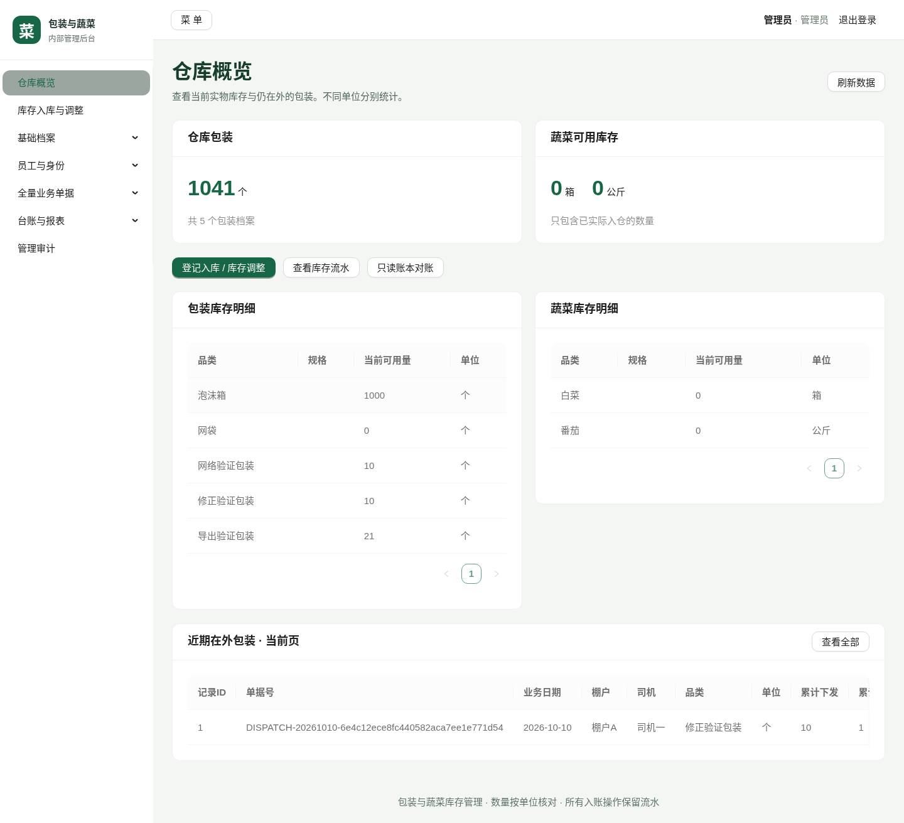
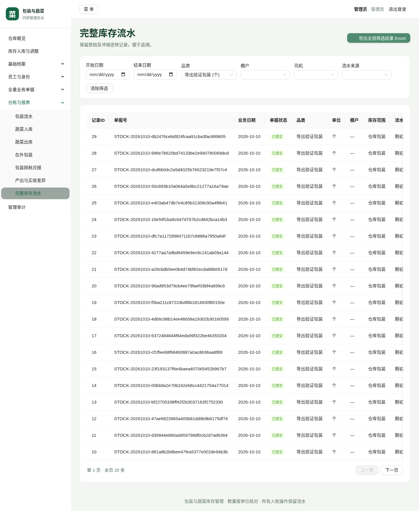

# 管理员操作指南

实际云托管 HTTPS 地址后加 `/admin/`，使用已经初始化的管理员账号密码登录。以下截图来自真实本地后台/MySQL测试，数据是隔离测试数据；用户实际云入口仍需验收。

1. 在“基础档案”维护棚户、包装、蔬菜和客户；单位使用后不能随意改动，历史单据保留快照。
2. 在“员工与角色”登记姓名、唯一手机号与岗位。普通员工不需要密码；本人微信首次确认身份后开通。手机号授权不可用时，进入“开通协助审批”线下核实本人，批准后员工仍需确认。
3. 在“库存入库与调整”登记期初、补充、外来菜或有原因的调整。核对明细和方向后确认；草稿不改变库存。不要直接在数据库覆盖余额。
4. 在“全量业务单据”查看日期、记录人、状态和明细。草稿可修改/删除/提交；已提交单据用“冲销原单”或“冲销并重建修正”，填写核实原因。存在依赖时点击列出的单号，按逆序处理。
5. 在“台账与报表”选择日期、品类、棚户、司机和适用来源。Excel导出的是全部筛选结果，包含统计口径和分单位合计；箱与公斤不要相加。
6. 概览的“只读账本对账”不修改数据。如果提示差异，保留单号和请求ID交给维护人员；不要用重复出库或清零试验生产系统。

提交后提示结果未确认时，点“确认原提交结果”。刷新后仍会保留原 key 与请求内容，不再开一张相同单据。正式版本发布后应验证 HTTPS、Cookie/CSRF、路由刷新和Excel下载，详见 [frontend-setup.md](frontend-setup.md)。

## 后台管理员与操作日志

管理员在“员工与角色”新增后台管理员账号并设置独立密码；后台管理员可管理下级员工、岗位和开通审批，默认还可查询和导出业务数据；同级/上级后台账号仅由管理员维护。业务写权限通过“后台管理员权限配置”逐项授权。“管理审计”提供后台操作记录和业务变更明细，可查询谁在何时查了哪些条件、导出哪些数据，以及修改和删除的成功或失败结果。已有库先执行 005 升级 SQL 再发布服务，详见 [后台管理员权限和后台操作审计](backoffice-permissions-audit.md)。

## 小程序管理员动态（1.2.0）

已有库先执行包内006升级SQL。在网页后台编辑原管理员，填写本人唯一手机号并保留ADMIN及原密码；修改手机号后重新登录。本人微信在小程序核实手机号并确认姓名，即可进入管理员工作台。页面显示时约5秒刷新装菜、实收回库、发货出库和其他库存动态，点开查看当时快照、标记已读；离开页面停止刷新。

装菜产出尚未入库，实收回库才增加仓库库存。订阅微信服务通知需要先配置真实模板，然后点击“订阅下一次微信提醒”；普通一次性订阅有授权次数限制。具体配置见 [1.2.0发布说明](miniprogram-release-1.2.0.md)。管理审计模块筛选“小程序库存动态”可查看管理员的查询和已读、订阅操作。
