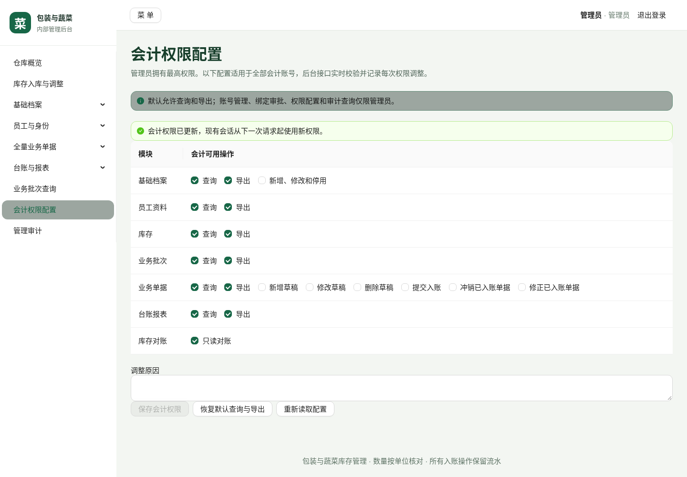

# 后台管理员权限和后台操作审计

已有 `admin` 账号继续保留最高权限。原 `ACCOUNTANT`（会计）显示名称改为后台管理员，保持原角色标识、账号密码和权限配置，使用账号密码登录 `/admin/`，后台管理员权限仅适用于后台 Cookie 会话，不赋予小程序额外权限。

本次1.2.2角色调整不新增迁移；已有005/006的业务库无需再执行SQL。员工查询 `users.read` 是固定职责，不可撤销，其他业务权限仍可配置。职级边界见[职级说明](backoffice-role-hierarchy.md)。

## 已有云数据库升级

先在当前业务数据库中完整执行 [wechat-cloudrun-upgrade-005.sql](../database/wechat-cloudrun-upgrade-005.sql)，再发布本次代码。默认数据库为 `vegetable_prod`；其他库名需修改脚本 `USE`，并与当前运行版本的 `MYSQL_DATABASE` 一致。数据库工具应使用支持 `DELIMITER` 的脚本执行模式。也可以用新版应用的 `APP_COMMAND=migrate` 执行迁移，然后移除此环境变量再启动服务。

升级脚本只新增权限表、后台请求操作日志表和第 005 条迁移记录，不更改账号、密码、库存、单据或历史流水。要求已正确执行 001—004；005 校验一致时重复执行会跳过，保留已经调整的后台管理员权限。若发现部分升级或历史迁移校验不一致，会报错并要求检查。MySQL DDL 不支持整份事务回滚，遇到失败应检查已创建的结构。**已有业务库不要重新执行首次初始化脚本。**

首次部署空业务库仍使用 [wechat-cloudrun-init.sql](../database/wechat-cloudrun-init.sql)，其中已包含 005。

## 创建后台管理员账号

管理员进入“员工与角色”→“新增员工”，填写姓名、唯一账号、手机号，选择“后台管理员”，设置 12—128 字符的独立后台密码并保存。后台管理员用该账号密码登录同一 `/admin/` 入口。编辑账号留空密码则保持原密码；修改账号会撤销旧会话。后台管理员无需选择管理员岗位。

| 操作 | 管理员 | 后台管理员默认权限 |
| --- | --- | --- |
| 档案、员工资料、全部业务单据、业务批次、库存查询 | 允许 | 允许 |
| 各类数据及七类报表 Excel 导出 | 允许 | 允许 |
| 只读库存对账 | 允许 | 允许 |
| 新增、修改、停用基础档案 | 允许 | 默认关闭，可配置 |
| 新增、修改、删除草稿及提交入账 | 允许 | 默认关闭，逐项配置 |
| 已入账单据冲销、原子修正 | 允许 | 默认关闭，逐项配置 |
| 下级员工及岗位管理、微信开通审批与解绑 | 允许 | 允许，不能维护同级或上级后台账号 |
| 同级及上级后台账号管理 | 允许 | 不允许 |
| 权限配置、操作日志及审计明细查询 | 允许 | 不允许 |

管理员选择“后台管理员权限配置”，勾选后台管理员可用操作，填写调整原因并确认保存。配置应用于全部后台管理员账号；其他业务操作必须同时保留对应查询权限。恢复默认按钮只选择默认项，仍需填写原因并保存才能生效。管理员权限不受此配置影响。

后台每次请求从数据库读取有效权限，已登录后台管理员从下一次请求起受新配置约束；无需重新登录。网页返回前台、刷新页面或权限拒绝后会重新读取权限，菜单与按钮同步调整。并发调整用版本号保护，旧版本保存返回 `VERSION_CONFLICT`，需要重新读取配置。已获授权的写操作仍遵守库存事务、幂等键、草稿版本和单据依赖检查；权限配置不允许绕过业务校验。

## 管理员查询操作记录

“管理审计”有两部分：

- **后台操作记录**：每次已认证后台 API 请求，包括查询、导出、新增、修改、删除、提交入账、冲销、修正、权限配置及成功登录/退出。记录操作者 ID、账号、姓名、操作时角色、对象路径、查询条件、请求 ID、HTTP 结果、错误代码和耗时。后台管理员被拒绝的操作及 CSRF 拒绝也记录。可按操作者、后台角色、操作类型、模块、日期、HTTP 状态和请求 ID 筛选，支持导出全部筛选结果（上限 50,000 行）。
- **业务变更明细**：保存档案、账号、绑定、权限及业务单据变更前后内容；补充草稿创建、修改和删除。业务审计与业务修改在同一事务中提交，回滚时不会产生虚假的成功变更。

点击操作记录的“查看操作”可查看筛选条件及同一请求 ID 对应的变更明细。查询和导出通常没有业务变更；拒绝的操作同样不会修改业务数据。已提交单据仍通过冲销或修正处理，删除只针对草稿并保留作废历史。

操作日志在业务执行前先写入开始记录；开始记录无法落库时不执行该后台业务请求。完成状态写入失败时保留 `STARTED`，界面显示“进行中 / 结果未确认”，不会假报成功。应结合请求 ID、业务变更和日志排查该记录。权限调整本身也保留前后权限列表和原因。

审计不记录请求体、登录密码、密码哈希、Cookie、CSRF 令牌、微信凭证或幂等密钥。查询条件采用白名单。用户变更仅记录必要的账号、姓名、角色、启用状态和密码是否调整，员工密码与手机号不会进入用户变更明细；员工资料导出不包含密码哈希或微信身份凭证。

历史查询无法补录；后台请求操作记录从本版本部署并完成迁移后开始。升级前已有的业务变更审计仍可查询。用户已经确认原后台可登录，本次后台管理员权限和审计功能的实际云端部署仍需完成上述升级与发布。

## 接口

| 接口 | 用途 |
| --- | --- |
| `GET /api/auth/me` | 返回当前身份及 `permissions`，后台登录结果也包含此字段 |
| `GET /api/backoffice-permissions` | 管理员读取后台管理员权限目录、当前选择及版本 |
| `PUT /api/backoffice-permissions` | 管理员提交 `{version, permissions, reason}` |
| `GET /api/exports/{resource}` | 按模块查询和导出权限导出全部筛选数据 |
| `GET /api/backoffice-operation-logs` | 管理员分页查询操作记录 |
| `GET /api/backoffice-operation-logs/excel` | 管理员导出操作记录 |
| `GET /api/audit-logs` | 管理员查询业务变更，可用 `requestId` 关联操作记录 |

数据导出资源：`growers`、`packaging-types`、`vegetable-types`、`customers`、`users`、`inventory-packaging`、`inventory-vegetables`、`batches`、`dispatches`、`work-records`、`recoveries`、`outbounds`、`stock-documents`。报表沿用 `/api/reports/{name}/excel`，权限单独控制。业务单据按明细展开，DIRECT 展示数量为负、实物数量为正；已入账单据保留品类/单位快照，草稿使用当前档案。库存导出是当前余额，库存历史查询通过流水报表进行。

新增操作日志筛选项：`actorId`、`action`、`module`、`statusCode`、`role`、`requestId`，以及原有 `from`、`to`、`search`、`page`、`pageSize`。日期按上海业务时区，日志原始时间为 UTC。
