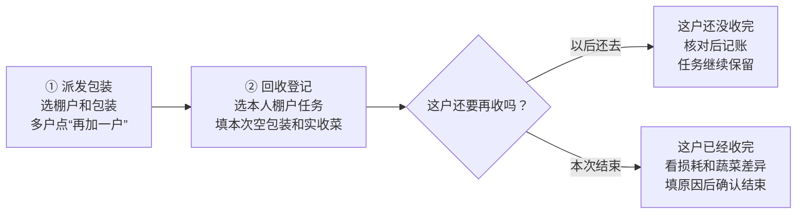

# 员工操作图解

此指南对应已编写的小程序页面。原生页面控制器已连接真实本地后台/MySQL验证；微信真机、系统大字号和现场员工试用尚未进行，需要按 [检查清单](miniprogram-verification.md) 完成。

首次使用由管理员先登记本人姓名、手机号和岗位。在本人微信点“开始使用”→“用微信手机号核实身份”→核对姓名→“是我，确认绑定”。姓名不对点“不是我，联系管理员”；不方便授权可申请管理员协助，批准后仍由本人确认。以后正常进入不用重复授权手机号。

## 装菜人员：一页指引

选棚户时点大卡片，也可搜索姓名。同一棚户有多个任务，核对派发日期。后台只建好棚户档案还不会生成装菜任务；须先由司机在“新建派发任务”选棚户、填写包装并确认记账。包装数量填这次用掉多少；蔬菜数量填这次装好多少，箱填整数，公斤可填小数。产出尚未入仓，由司机实收后才计入仓库。

数量填错先“返回修改”。已提交的记录到“我的记录”查看；已记好后数量有误，把单号告诉管理员。网络不好点“先保存，稍后记”；草稿还未入账。

## 司机：一页指引

回收填本次运回数量，不填累计量。没运回的品类留空。还没收完时不会提前算损耗；已经收完时，未收回包装记损耗，原因可选损坏、遗失或其他。其他要写说明。实收与装菜产出不同，要写差异原因。

只有看到“已记好”与单号才算成功。若提示还未确认结果，点“继续确认原提交”，不要另开相同单据。首页会显示本人仍未完成的棚户任务。

## 出库员

选择正常出库或手工出库→选择客户→填写实际出库正数→核对后确认。手工出库必须说明来源；它会扣实际库存，报表以负数显示，员工不用自己输入负号。
