# 棚户记账使用手册

**适用版本：1.2.1 · 网页管理后台 + 微信小程序**

从管理员添加用户，到司机派发、装菜登记、回收入库和发货出库，按本手册依次操作即可。

小程序是微信内使用的应用，无需另外安装手机 APP。管理后台由管理员和会计在电脑浏览器中使用。

| 使用者 | 使用入口 | 主要工作 |
|---|---|---|
| 管理员 | 网页后台、小程序 | 添加用户、维护档案、入库调整、权限、报表、审计；手机查看库存动态 |
| 司机 | 微信小程序 | 派发包装、回收包装与蔬菜、结清本人棚户任务 |
| 装菜人员 | 微信小程序 | 选择开放任务，登记本次包装消耗与蔬菜产出 |
| 出库员 | 微信小程序 | 查询蔬菜库存，正常或手工出库 |
| 会计 | 网页后台 | 默认查询与导出；其他业务权限由管理员配置 |

**业务顺序：**管理员建档及录入实际库存 → 司机派发包装 → 装菜人员登记消耗及产出 → 司机实收回库 → 出库员发货 → 管理员/会计核对。

**截图说明：**后台截图来自本机隔离演示环境；小程序截图为当前页面的浏览器布局示意，并非微信真机截图。姓名、手机号、客户、日期和数量都是演示数据。使用时请填写本人和实际业务资料。

本手册不包含任何真实密码或登录凭证。完整流程用“1000个包装、12箱白菜”举例，已有账目请接着使用，不要为了照例重复录入期初。

<!-- page -->

## 01 管理员：进入后台并添加员工

后台地址：**https://dotnet-4jwm-326107-6-1503430980.sh.run.tcloudbase.com/admin/**

1. 在电脑浏览器打开后台，填写管理员账号和密码，点“进入管理后台”。
2. 左侧展开“员工与身份”，进入“员工与角色”，点“新增员工”。
3. 填写“本人姓名 / 称呼”“唯一账号”“本人手机号”。账号不能重复；手机号必须是本人正在使用的11位大陆手机号，并与其他用户区分。
4. 勾选岗位，保持“账号启用”打开，点“保存员工”。普通司机、装菜人员和出库员无需填写后台密码。

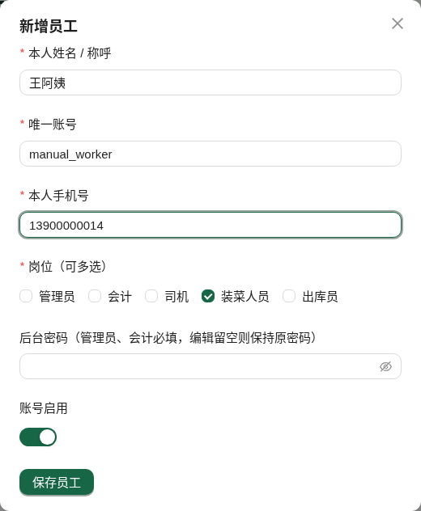

**岗位可多选。**例如同一人兼任司机和出库员，可同时勾选两个岗位，之后在小程序“我的身份”切换。没有勾选的岗位不会成为可选项。

<!-- page -->

## 02 管理员：会计账号、管理员手机号与人员变更

1. 新增会计时，取消不需要的岗位，勾选“会计”，填写独立后台密码并保存。新管理员和新会计密码需12—128字符。
2. 告知会计其唯一账号和密码，让其从网页后台登录。会计岗位在本版不提供独立的小程序工作台。
3. 管理员本人也要用小程序时，编辑原管理员账号，填写本人唯一手机号并保留“管理员”岗位；不更换密码时，编辑密码框留空。
4. 修改账号后旧会话会撤销，相关人员重新登录。离职人员将“账号启用”关闭即可停用。

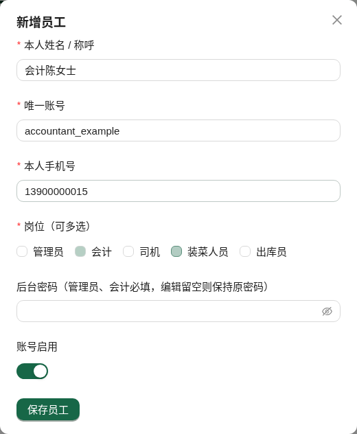

**更换微信：**先线下核实本人，在“员工与角色”点击对应用户的“解绑微信”，填写原因并确认。本人再用新微信完成首次确认。不要把同一账号交给多人共同使用。

<!-- page -->

## 03 管理员：准备档案和实际库存

1. 在“基础档案”分别维护棚户、包装、蔬菜和客户，确认档案处于启用状态。
2. 包装通常用“个”；蔬菜可用“箱”或“公斤”。箱/个填整数，公斤可填最多3位小数。品类已经使用后，单位不能随意变更。
3. 进入“库存入库与调整”，选择期初、补充或相应业务来源，选品类及单位，填写**本次正数数量**。出向调整也填正数，由方向决定增减。
4. 点“检查并提交”，核对确认窗中的品类、数量、方向，再点“确认记账”。只有入账成功才改变库存。

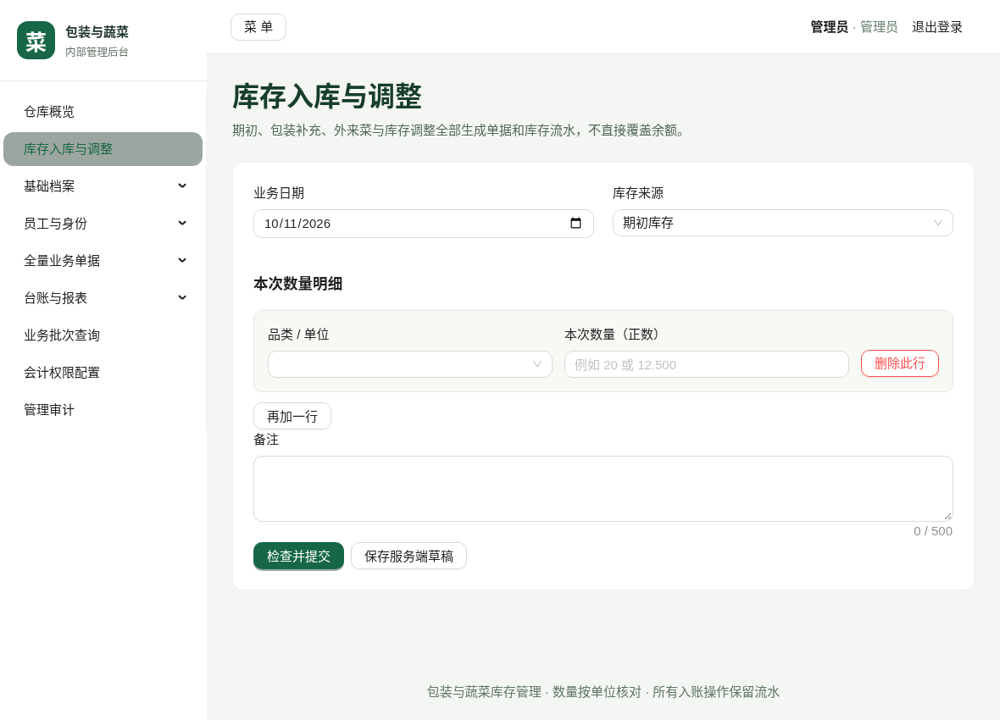

**演示起点：**仓库实际有1000个泡沫箱、白菜0箱。已经有生产库存的库不要再次录入这1000个演示数量。

<!-- page -->

## 04 所有小程序员工：首次确认本人身份

1. 用本人微信打开小程序，点“开始使用”。
2. 首次使用点“用微信手机号核实身份”，授权的手机号须匹配管理员登记的本人手机号。
3. 核对显示的姓名与岗位，确认正确后点“是我，确认绑定”。
4. 姓名不对，点“不是我，联系管理员”，停止绑定，先让管理员核实。

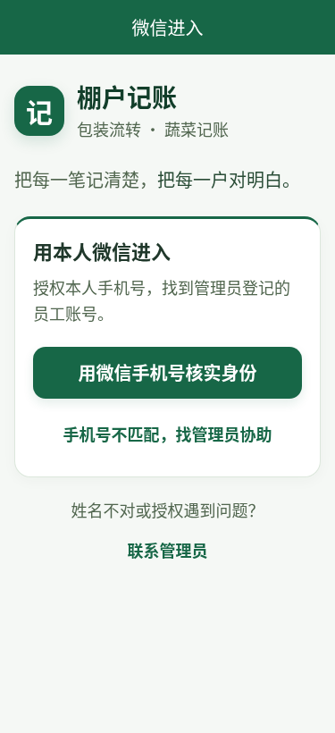
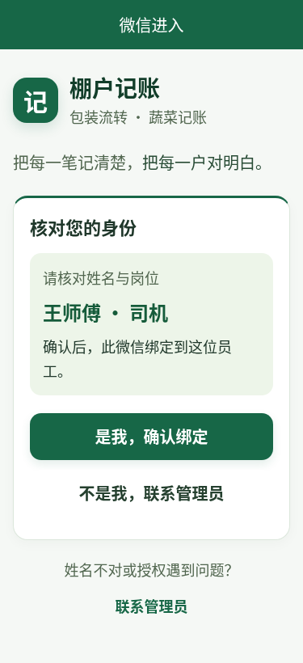

**以后使用：**正常打开会恢复微信身份，无需重复授权手机号。会话失效时重新进入。小程序不用网页后台的账号密码登录。

<!-- page -->

## 05 手机号不匹配、协助开通与切换岗位

1. 无法授权或手机号没有匹配时，点“手机号不匹配，找管理员协助”，再点“申请管理员协助绑定”。
2. 管理员在网页“员工与身份 → 开通协助审批”点“刷新申请”，线下核实本人，点“核实并批准”，选择正确的预录员工，填写原因，提交决定。
3. 员工回小程序点“查看核实结果”，仍须核对姓名并确认本人；申请或批准本身不会代替本人确认。
4. 多岗位人员进入“我的身份”，点本次要使用的岗位，再进入对应工作台。

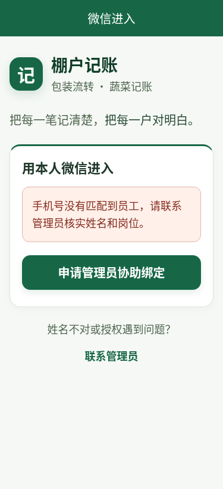
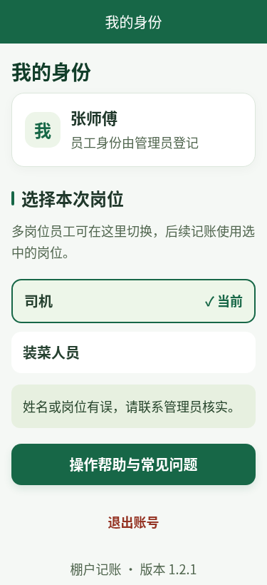

**注意：**姓名、岗位有误先联系管理员。更换手机或微信不要借用其他员工的已绑定账号。

<!-- page -->

## 06 司机：派发包装给棚户

1. 选择“司机”岗位，在工作台点“派发包装”。
2. 选择业务日期和棚户，选择包装品类，填写这次送出的数量。
3. 一户多种包装点“这户再加一种包装”；一次送多户点“再加一户”。每户分别填，不要混在一户名下。
4. 向下滑动，点“下一步，核对本次记录”，核对棚户、日期、包装、数量，再“确认记账”。

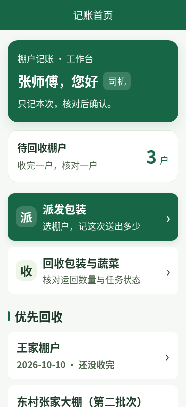
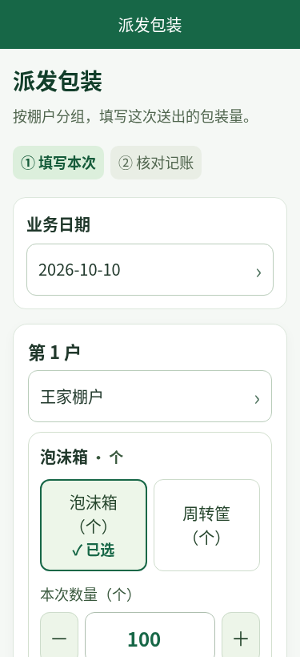

**演示结果：**派发100个后，仓库1000 → 900个；该棚户在外包装为100个，并生成可装菜、可回收的任务。草稿尚未派发。

<!-- page -->

## 07 装菜人员：选对棚户与本次任务

1. 选择“装菜人员”岗位，点“装菜登记”。
2. 点“选择棚户任务”，核对棚户、派发日期和司机。一个棚户有多个任务时，请手选正确批次。
3. 在“本次包装消耗”选择该派发任务可用的包装，填本次实际用掉多少。
4. 在蔬菜产出区域选品类及单位，填本次装好多少。可以添加其他品类，未发生的项目留空。

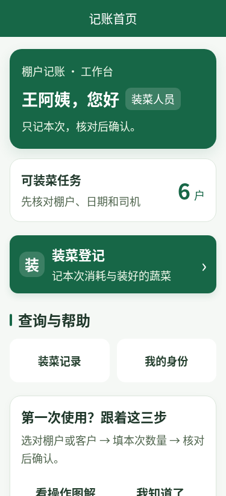
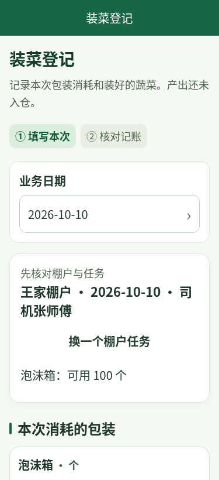

**演示填写：**这次用了70个泡沫箱，装好12箱白菜。这里登记的是产出，**12箱此时还没有进入仓库库存**。

<!-- page -->

## 08 装菜人员：核对并完成记账

1. 向下滑动，确认产出数量与单位，按需填写备注。
2. 点“下一步，核对本次记录”，逐项看棚户、包装消耗和蔬菜产出。
3. 有误点“返回修改”；正确点“确认记账”。看到“已记好”和单据号才算成功。
4. 在工作台“装菜记录”可查看自己的历史记录。已入账数量有误，将单号交给管理员处理。

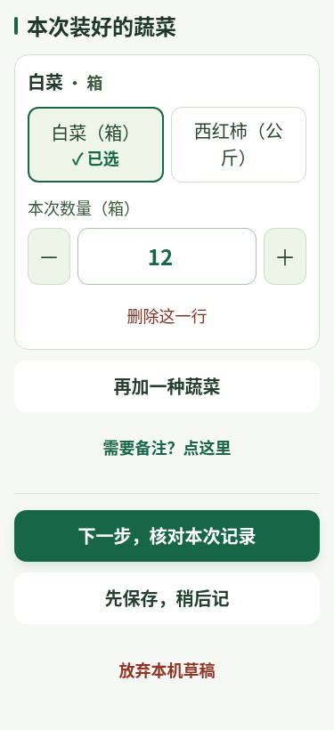
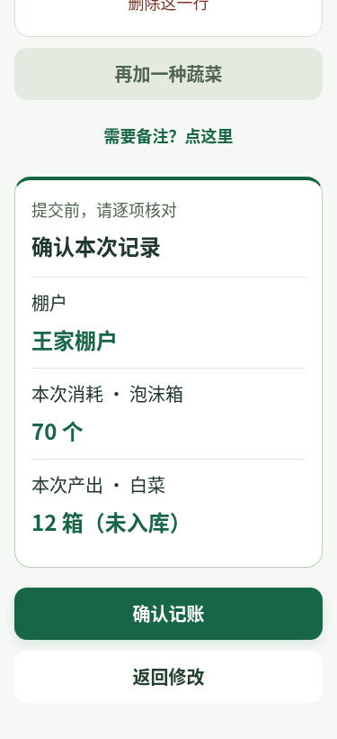

**演示结果：**该棚户在外未消耗包装100 → 30个；仓库包装仍为900个；白菜仓库仍为0箱。不要因为装好12箱就提前当作可出库库存。

<!-- page -->

## 09 司机：回收空包装与实收到仓蔬菜

1. 在司机工作台点“回收包装与蔬菜”，或点“优先回收”中的棚户任务。
2. 核对棚户、日期、司机，填写**本次**运回的空包装和实收到仓的蔬菜，不填累计量。
3. 后面还要去收，选择“这户还没收完（任务继续）”；这次结束整户任务，选择“这户已经收完（结束任务）”。
4. 最终收完时有包装损耗须选原因；选“其他”补说明。蔬菜产出和实收不一致时填写差异原因。

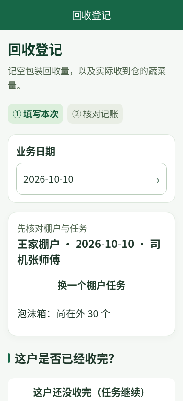
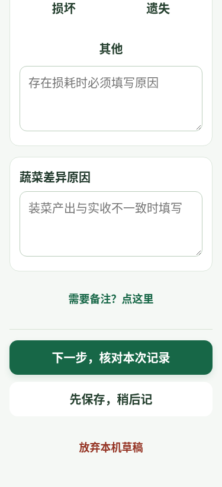

**分次回收：**每次实收都入库，任务继续；未结清时不会提前计算最终损耗。本例选择最终收完：空包装25个、白菜12箱。

<!-- page -->

## 10 司机：最终收完与结果确认

1. 点“下一步，核对本次记录”，核对下发、消耗、回收、损耗及蔬菜实收。
2. 本例：下发100 − 消耗70 − 回收25 = **损耗5个**，原因填写“损坏”。
3. 确认不再继续本任务后，点“确认收完，记账并结束这户”。
4. 看见“已记好”和单号后返回首页；已结束任务不能继续追加装菜或回收。

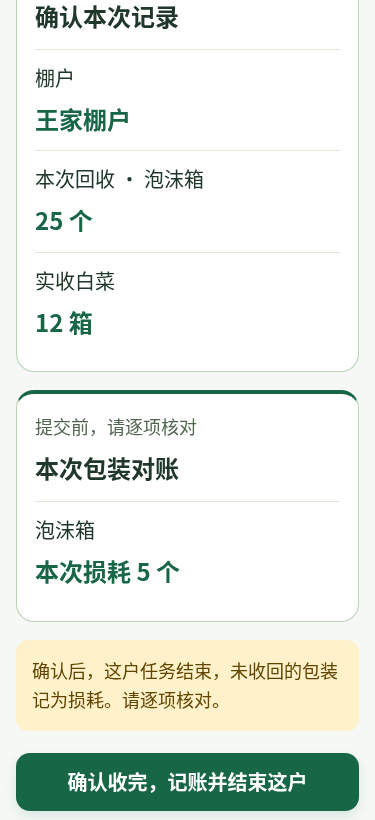
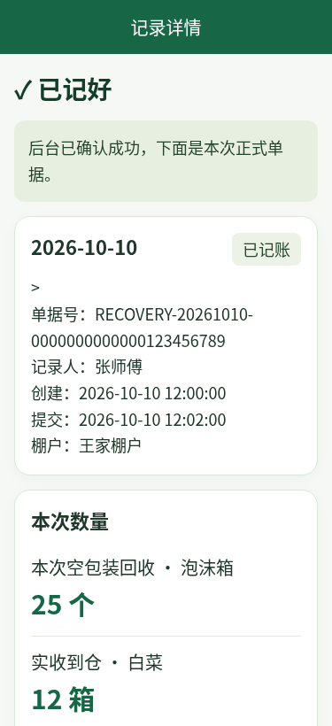

**演示结果：**仓库包装900 + 25 = **925个**；白菜仓库0 + 12 = **12箱**。装菜消耗70个不会在仓库再扣一次。

<!-- page -->

## 11 出库员：正常出库

1. 选择“出库员”岗位；可先点“蔬菜库存”确认可用数量。
2. 点“正常出库”，选择日期和客户，再选择蔬菜品类。
3. 填这次实际发出的**正数数量**。箱数填整数，公斤保留最多3位小数，不得超过实际可用库存。
4. 点“下一步，核对本次记录”，核对客户、品类、单位和数量后“确认记账”。

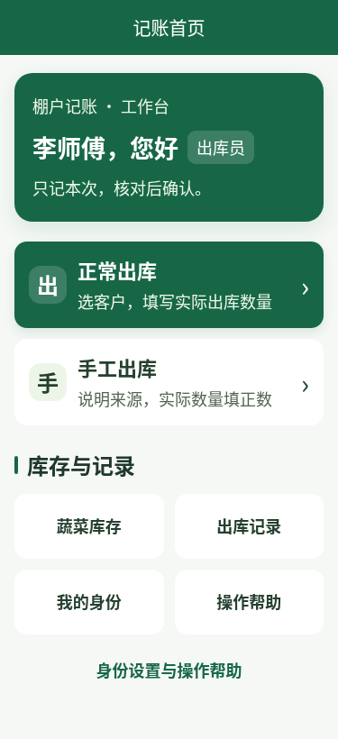
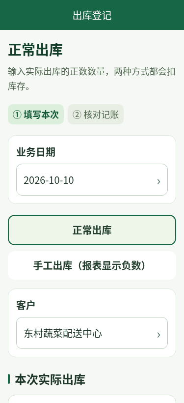

**演示结果：**正常出库3箱，白菜仓库12 → **9箱**。查询和导出不会扣库存，正式入账才扣减。

<!-- page -->

## 12 出库员：手工出库

1. 在出库员工作台点“手工出库”，或在出库页面切换该模式。
2. 同样选择日期、客户、蔬菜品类，填写实际出库的**正数数量**。
3. 向下滑动填写“手工出库来源（必填）”，写清真实来源或交付说明。
4. 核对后“确认记账”；这也是实际出库，会扣仓库库存。

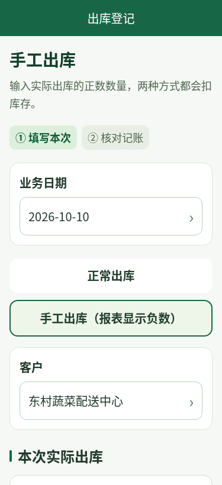
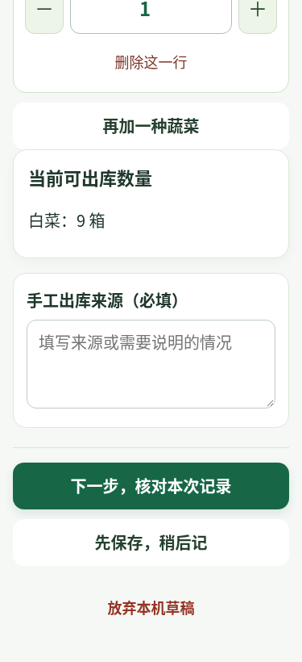

**演示结果：**再手工出库1箱，仓库9 → **8箱**。详情实际量为1箱，报表展示量为−1箱；员工不用输入负号，手工出库不是入库或退货。

<!-- page -->

## 13 小程序查询：库存、历史记录与本人岗位

1. 出库员可查“蔬菜库存”；管理员可查全部蔬菜与仓库包装。库存按品类和单位分别显示。
2. 在对应工作台进入派发、回收、装菜或出库记录；按开始、结束日期筛选。
3. 点“查看这笔记录”查看单号、记录人、时间、数量和状态；下一页继续看历史。
4. 普通员工主要查看本人记录；司机只能处理本人负责的棚户任务，不能替另一个司机回收。

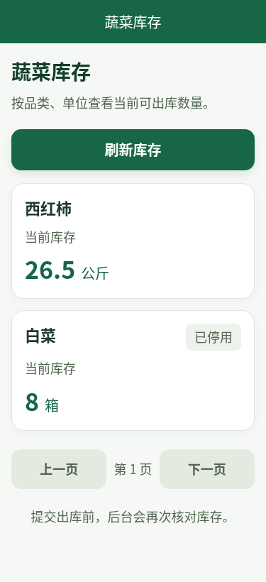
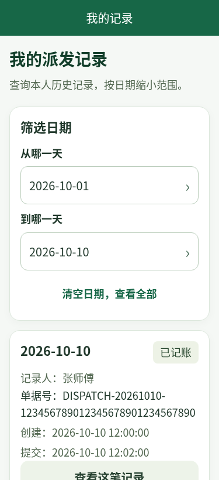

**三个状态：**草稿＝尚未入账；已记账＝正式成功；已冲销＝管理员已撤销该单的业务效果。箱和公斤不能相加。

<!-- page -->

## 14 管理员小程序：库存动态与未读提醒

1. 原管理员已登记本人手机号后，用本人微信完成身份确认；选择“管理员”进入专用工作台。
2. 页面显示时约5秒刷新。看未读数量和上次更新时间，点“刷新动态”立即查询。
3. 点一条动态进入“本次变动详情”，查看操作人、棚户/客户、增减量与入账时库存快照。
4. 点“全部已读”标记当前查到的动态；历史较多时“查看更多历史动态”。有新动态提示时点击回到最新列表。

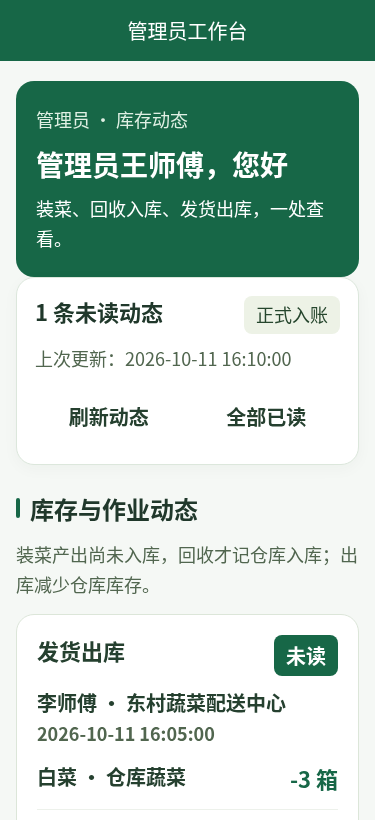
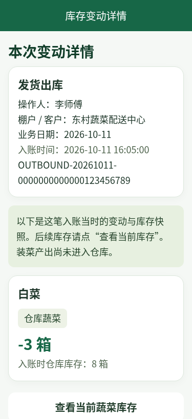

完整明细与当前库存分开看：**历史余额是入账当时快照**；点“查看当前蔬菜库存”查询现在余额。离开工作台停止轮询，返回后继续查询。

<!-- page -->

## 15 管理员小程序：主动订阅微信库存提醒

1. 在管理员工作台向下滑到“微信服务通知”。
2. 点“订阅下一次微信提醒”，在微信授权窗口选择允许。
3. 员工下一笔正式入账或正式冲销后，后台按本人的订阅授权发送库存更新提醒。
4. 点微信消息可进入对应动态明细；不愿接收时“暂停微信提醒”，需要时再恢复。

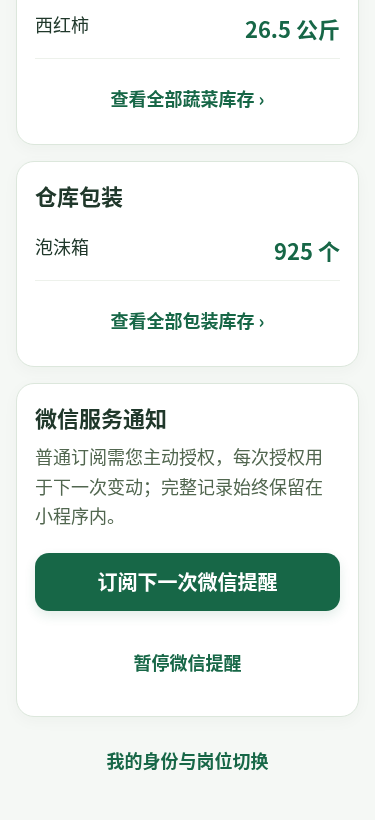

**一次性授权：**每次接受订阅用于下一笔新变动，不能无限持续推送。授权不足可再次主动订阅，拒绝订阅不影响页面内完整动态。

**断网登记：**提示待同步时点“同步订阅结果”。看到“送达结果未确认”时先查看动态，系统不会盲目重复发送。“已被微信接收”不表示用户已经阅读。

模板74963显示操作人、更新时间、温馨提示；温馨提示概括首个品类增减，全部项目通过小程序明细查看。真实微信推送须在已部署的体验版/正式版验收。

<!-- page -->

## 16 会计：网页查询与导出

1. 打开同一管理后台地址，用管理员分配的会计账号及独立密码登录。
2. 默认可查询档案、员工、库存、业务批次、单据和台账报表，并按允许的范围导出。
3. 展开“台账与报表”，选包装流水、蔬菜入库/出库、在外包装、损耗月报、差异或完整库存流水。
4. 填日期、品类及适用筛选条件，点“导出全部筛选结果 Excel”。导出全部符合条件的数据，不仅当前页。

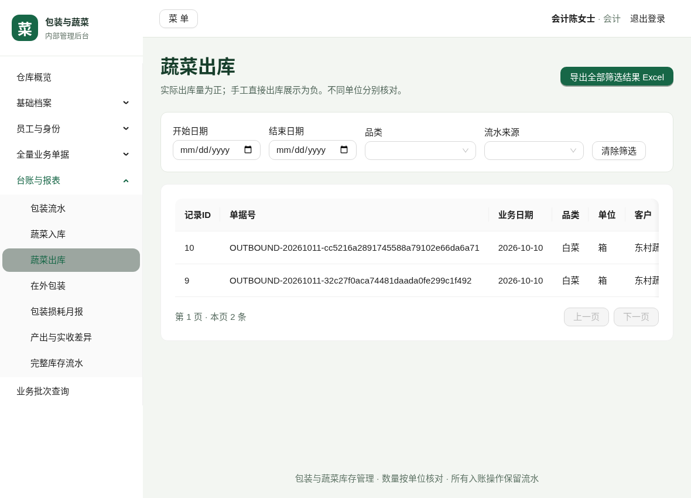

表格较宽时向右滑动查看数量列。正常出库和手工出库都减少库存；“实际数量”与“展示数量”口径不同，不要把展示负号理解成入库。

没有修改、删除或冲销按钮时，说明当前未获相应权限。请联系管理员，不能通过其他岗位或账号绕过。管理员、会计的后台操作会留痕。

<!-- page -->

## 17 管理员：配置会计业务权限

1. 在网页后台进入“会计权限配置”，查看模块和当前勾选项。
2. 默认保留查询、导出；需要临时维护档案或单据时，只勾选相应业务操作。
3. 填写“权限调整原因”，点“保存会计权限”，核对确认窗口并“确认保存”。
4. 会计已有会话从下一次请求起使用新权限；任务结束后取消对应写权限并再次保存。

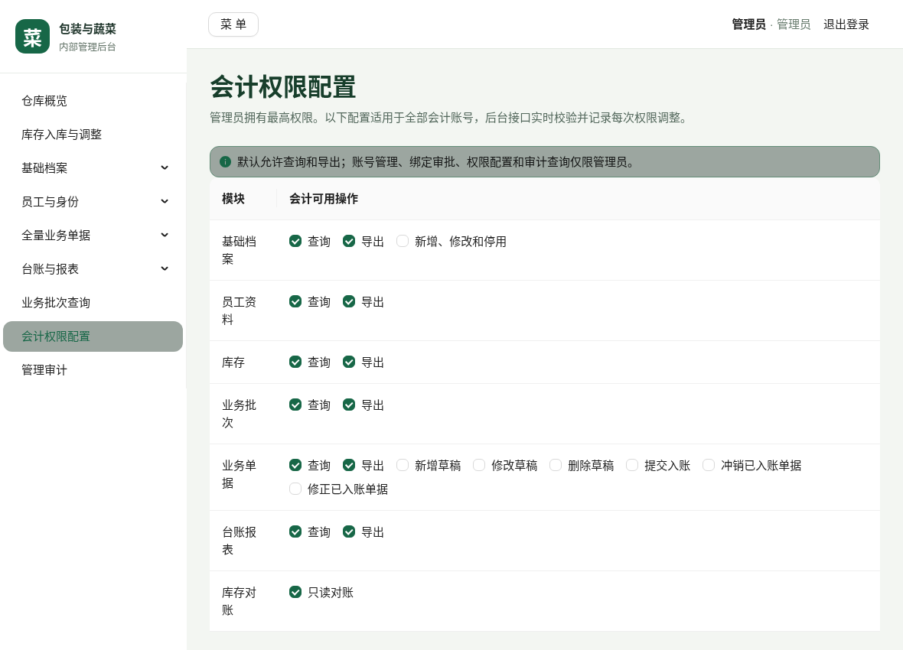

**配置作用于全部会计账号。**管理员始终保留最高权限；账号/角色管理、绑定审批、会计权限配置和审计查询仍仅限管理员，不能通过此页授予会计。

查询权限被取消时，相应操作权限也会一并取消；界面与服务器都校验权限。

<!-- page -->

## 18 管理员：查询每一次后台操作

1. 进入“管理审计”，选择后台操作记录。
2. 按日期、角色、操作人、操作类型、操作模块、HTTP结果或请求ID筛选。
3. 查看成功和失败记录，包括查询、导出、新增、修改、删除、提交、冲销与权限配置。
4. 需要查具体改动时切换“业务变更明细”；用同一请求ID关联操作与变更前后内容，可导出允许的记录。

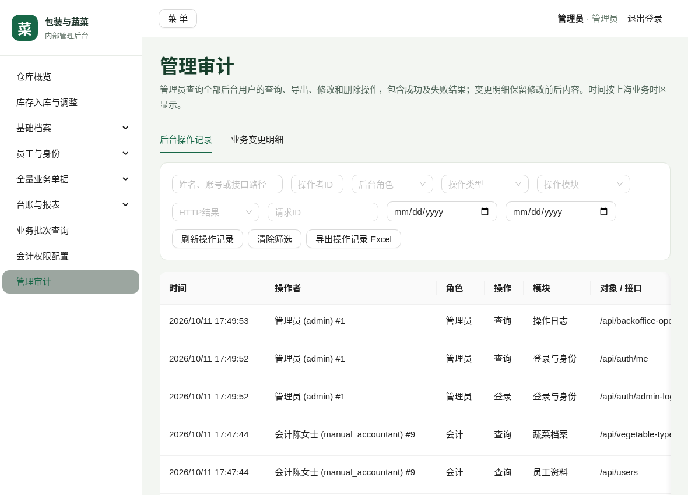

管理员小程序的动态查询、已读和订阅操作也留痕，模块选择“小程序库存动态”。会计不能查询管理审计。

删除只适用于允许删除的草稿；正式单据通过冲销处理。操作记录用于追溯，不用于直接覆盖库存余额。

<!-- page -->

## 19 管理员：改错单据、冲销与重新记账

1. 员工提供单据号后，在“全量业务单据”选择对应类型，打开详情，核对日期、创建人和数量。
2. 草稿可按界面修改、删除或提交；已入账单据不直接改库存或删除。
3. 正式单据用“冲销原单”，填写原因；需要同时纠正内容时用“冲销并重建修正”，填写新单内容并核对。
4. 提示存在依赖时，按提示单号先处理后续依赖。例如菜已出库，回收单通常不能直接冲销，应先处理依赖的出库，再回收、装菜或派发。

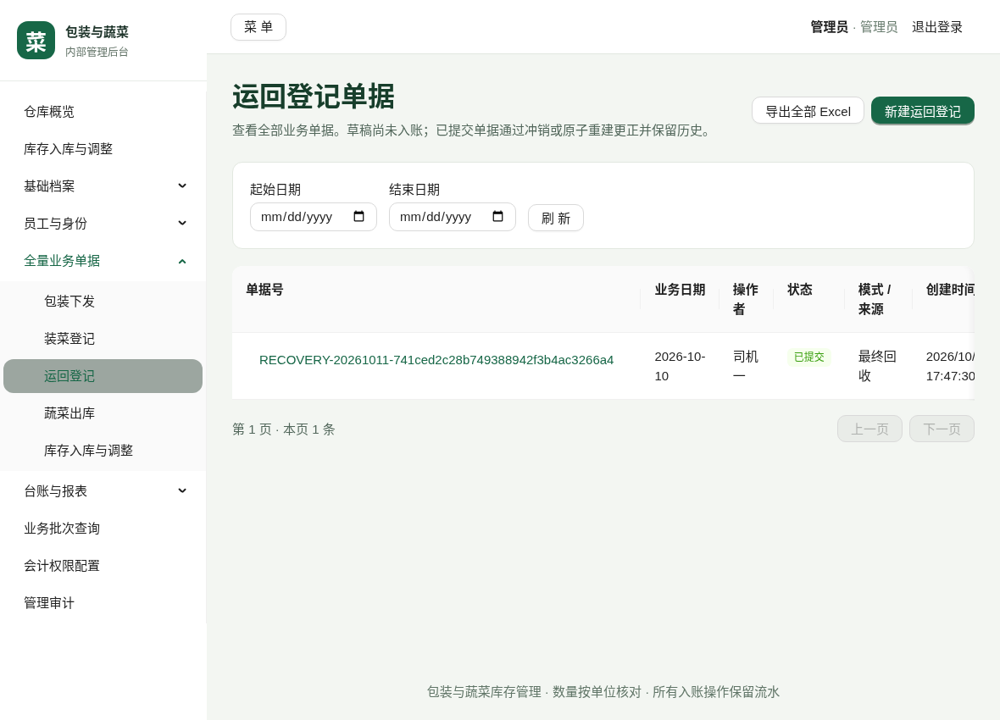

冲销与重建必须由有权限的人操作。失败或依赖拒绝不会部分改动库存；修正成功保留旧单、新单关联及原因。再到仓库概览点“只读账本对账”核实。

<!-- page -->

## 20 所有人：断网、重复点击与草稿

1. 尚未提交时，点“先保存，稍后记”，只保存**本机草稿**，不入账；仍用同一员工身份可回来继续填写。
2. 提交后若提示“这笔还没有确认是否记好”，联网后点“继续确认原提交”，保留原提交，不另开相同单据。
3. 看到“已记好”和单号再进行下一笔；下一笔数量重新填写。
4. “放弃本机草稿”不删除已经保存到后台的草稿。后台草稿需在相应单据中处理；切换账号或退出会清理本人业务草稿。

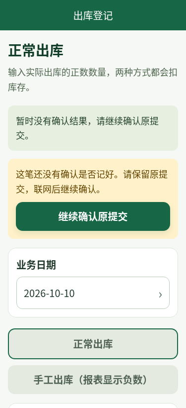

| 提示 | 应当怎么做 |
|---|---|
| 姓名/手机号不匹配 | 管理员核实登记资料，必要时走本人协助审批 |
| 库存不足 | 核对真实库存及是否已实收回库，不改为负数或重复提交 |
| 没有任务 | 核对司机是否正式派发、任务是否收完以及本人岗位 |
| 会话失效/无权限 | 重新进入；岗位变更由管理员处理 |
| 服务暂时不可用 | 保留单号和错误请求ID，稍后重试或联系维护人员 |

<!-- page -->

## 21 一条完整业务的对账示例

以下是**一条任务**的演示数量，不是要求您重新做一遍生产业务。

| 环节 | 本次动作 | 仓库包装 | 棚户在外未消耗包装 | 白菜仓库 |
|---|---|---|---|---|
| 实际期初 | 包装1000个、白菜0箱 | 1000个 | 0个 | 0箱 |
| 司机派发 | 下发100个 | 900个 | 100个 | 0箱 |
| 装菜登记 | 消耗70个、产出12箱 | 900个 | 30个 | 0箱 |
| 最终回收 | 实收包装25个、白菜12箱；损耗5个 | 925个 | 0个，任务结束 | 12箱 |
| 正常出库 | 发货3箱 | 925个 | 0个 | 9箱 |
| 手工出库 | 发货1箱 | 925个 | 0个 | 8箱 |

- 包装：1000 − 下发100 + 回收25 = **925个**。
- 任务包装：100 − 消耗70 − 回收25 = **5个损耗**；最终损耗计入结清记录，剩余在外结清。
- 白菜：实收12 − 正常出库3 − 手工出库1 = **8箱**。
- 产出12箱是装菜记录；实收12箱是入仓记录，二者不能重复入仓。

日常结束时，管理员或会计按业务日期核对台账与实际库存，分品类、分单位看。管理员可用“只读账本对账”核实数据库余额与流水是否一致。

**交给员工的简明口诀：**选对人和任务 → 只填本次 → 核对单位 → 确认记账 → 看见单号。结果不明，继续确认原提交。
